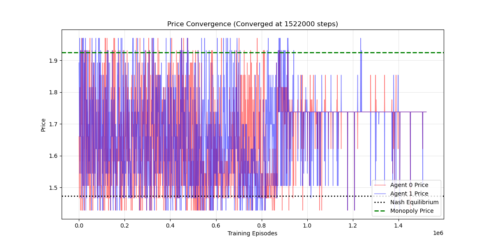
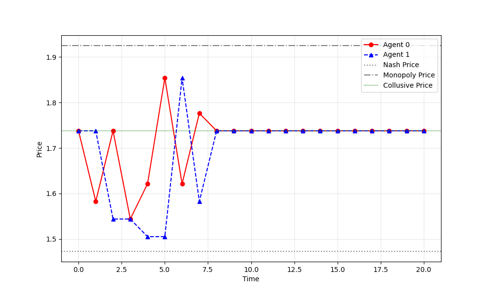
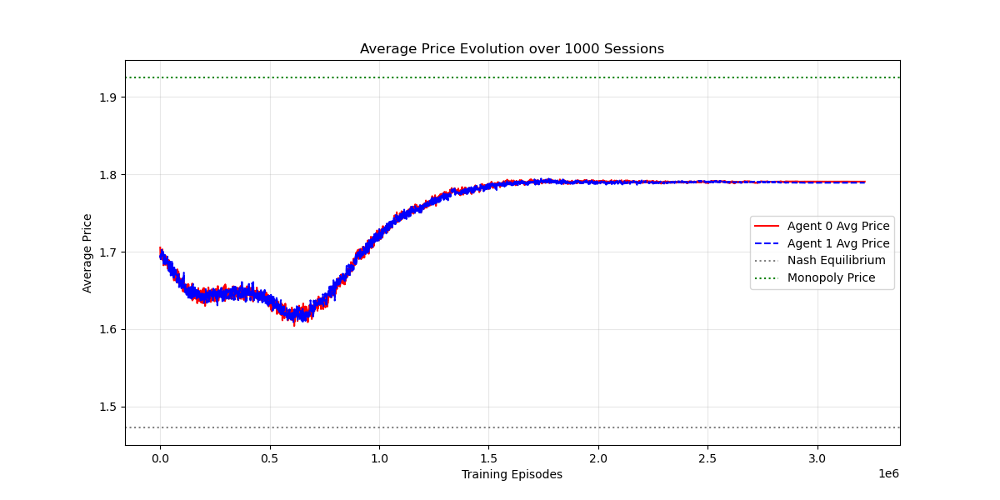
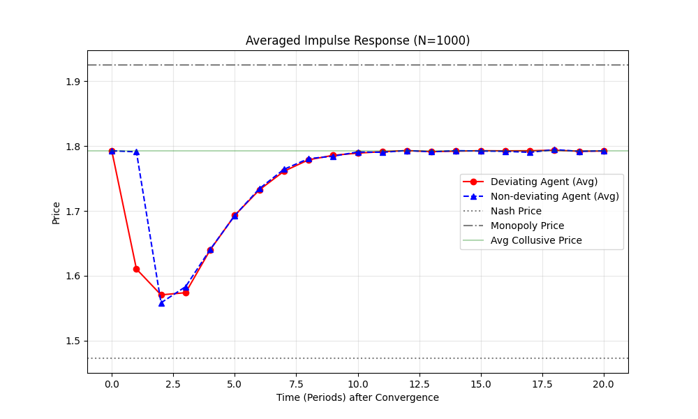

# 算法定价与合谋：Q-learning 论文复现

本项目是对 Calvano 等人（2020）论文 *Artificial Intelligence, Algorithmic Pricing, and Collusion* 的非官方课程复现。我们在对称双企业定价环境中训练两个表格型 Q-learning 智能体，观察学习后的价格，以及一方临时降价后的价格反应。

本项目展示论文的基准设定和背叛—惩罚机制，并非对所有实验的完整复现。以下图片是项目已有的实验结果；不同随机种子或参数可能产生不同轨迹。

## 结果展示

课程复现的补充说明和图表也见[说明文档](说明文档.pdf)。

### 单次训练

图示运行在约 152.2 万步时满足代码中的策略稳定判据。训练后段的价格高于静态 Nash 价格，但低于联合垄断价格。

在背叛实验中，第 1 期强制智能体 0 选择针对对手当前价格的静态最佳应对。随后另一方降价，双方价格经过数期调整后回到较高水平。

### 1000 次训练的平均结果

下图汇总 1000 对智能体的价格轨迹。按图上读数，后期平均价格约为 1.79，高于静态 Nash 价格（约 1.47），低于联合垄断价格（约 1.93）。批量脚本会用提前收敛实验的最后记录价格填充后续时间点，再计算均值；因此后段曲线包含这一处理。

平均背叛实验中，智能体 0 在第 1 期降价，另一方随后作出价格反应；平均价格逐步回到背叛前附近。

## 运行方法

使用 Python 3，安装所需依赖：

    python3 -m pip install numpy scipy matplotlib tqdm joblib

运行单次训练及背叛实验：

    python3 single_run.py

运行批量实验：

    python3 batch_run.py

脚本目前使用 Matplotlib 的交互窗口展示图形，不会自动将图片保存为 PNG。完整实验计算量较大：单次脚本的训练循环上限为 1000 万步；批量脚本默认运行 1000 次、每次最多 500 万步，并使用所有可用 CPU 核心。试运行时，可先调小 single_run.py 中的 max_steps，或 batch_run.py 中的 n_sessions 和 total_episodes。

## 默认设定

| 项目 | 默认值 |
| --- | ---: |
| 企业／智能体数量 | 2 |
| 离散价格数量 | 15 |
| 记忆长度 | 1 期 |
| 学习率 α | 0.15 |
| 折现因子 γ | 0.95 |
| 探索衰减参数 β | 4e-6 |
| 随机种子 | 42 |
| 批量实验次数 | 1000 |

需求函数等其他参数写在两个脚本的 Params 定义中。single_run.py 用于查看一次训练的细节；batch_run.py 用于汇总多次训练的平均轨迹。

## 复现范围与说明

- 已实现对称双企业基准模型、Q-learning 训练、价格趋势及背叛后的价格反应。
- 未复现论文中的参数网格搜索、非对称及多企业稳健性实验、策略网络可视化。
- 代码实现参考了 Gymnasium 的 [*Solving FrozenLake with Tabular Q-Learning* 教程](https://gymnasium.farama.org/tutorials/training_agents/frozenlake_q_learning/)，并使用 AI 辅助修改。这里的实现不代表原论文作者的官方代码。

## 原论文

Calvano, E., Calzolari, G., Denicolò, V., & Pastorello, S. (2020). “Artificial Intelligence, Algorithmic Pricing, and Collusion.” *American Economic Review*, 110(10), 3267–3297. [DOI: 10.1257/aer.20190623](https://doi.org/10.1257/aer.20190623)。
